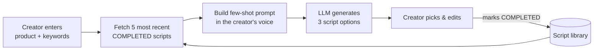

# Influens

**An AI script writer that learns to sound like *you*.**

Influens helps social media creators write short-video product scripts in their own voice. A creator types a product name and a few keywords. Influens returns three ready-to-film script options that sound like they wrote them, not like a generic AI copywriter.

This repository is the backend: a Flask API that powers the Influens web app.

---

## The idea

Creators who do product recommendations (fashion, shoes, handbags, beauty) put out a lot of content. Each video needs a script: introduce the product, say what's good about it, share how you use it, and keep it fun and personal. Writing these by hand every day takes a lot of time.

Generic AI writing tools don't solve this. Their output sounds the same for everyone: polished, bland and easy to recognize as AI. A creator's audience follows them **for their voice**: their slang, their humor, how they tell a story. Copy without that voice is no use to them.

Influens treats **the creator's voice as data**:

1. **Your past scripts are the training set.** When you set up a *script generator*, you seed it with scripts you've already written and published.
2. **Every generation is grounded in your recent work.** For each new product, Influens picks your most recent finished scripts and gives them to the language model as examples. It writes in your style instead of a default one.
3. **You stay the author.** Influens gives you **three options** rather than one, so you choose, mix and edit.
4. **The loop gets tighter over time.** When you mark an edited script as `COMPLETED`, it joins the example pool. The scripts you approve teach the next generation, so the generator keeps up as your style changes.



There's no fine-tuning, no model per user and no training pipeline. Personalization comes from what goes into the prompt, so a new creator can start with a handful of scripts and get on-voice drafts straight away.

### Script generators

A **script generator** is one voice profile. A creator can keep several, for example one per account, persona, product category or campaign tone. Each generator has its own script library, so one style never leaks into another.

---

## How it works

| Layer | Location | Role |
|---|---|---|
| API | `app.py` | Flask routes for auth, generators, scripts and generation |
| Generation | `generators/script_generator.py` | Pulls recent completed scripts, builds the prompt, calls the LLM |
| Prompting | `prompt/`, `prompt_templates/` | Fills the few-shot template with examples and the target product |
| LLM client | `llm/openai_wrapper.py` | OpenAI chat completions (GPT-4), with retry and backoff |
| Data | `database/database_controller.py` | MySQL storage for users, script generators and scripts |
| Auth | `user_authentication/` | Email sign-in |

### Script lifecycle

Each script has a status:

- `INPROGRESS`: a draft the creator is still working on
- `COMPLETED`: finalized; it is now **used as an example** in future generations
- `DELETED`: hidden from the library

---

## API

| Method | Endpoint | Description |
|---|---|---|
| `POST` | `/signin` | Sign in with `email` and `password` |
| `POST` | `/add_script_generator` | Create a generator seeded with existing scripts (`product_names`, `keywords_descs`, `scripts`) |
| `GET` | `/get_script_generators/<user_id>` | List a user's generators |
| `GET` | `/get_script_generator_name/<script_generator_id>` | Get a generator's name |
| `GET` | `/get_all_script_generator_id/<user_id>` | List a user's generator IDs |
| `POST` | `/generate_script_options` | **Generate three script options** for `product_name` and `keywords_desc` |
| `POST` | `/add_new_script` | Save a script to a generator's library |
| `POST` | `/edit_script` | Update a script's content or status |
| `GET` | `/get_recent_scripts/<script_generator_id>` | List a generator's scripts (excluding deleted ones) |
| `GET` | `/get_recent_script/<recent_script_id>` | Get one script |
| `GET` | `/get_all_script_generator_id_recent_script_id/<user_id>` | List generator and script ID pairs for a user |

Example:

```bash
curl -X POST http://localhost:5000/generate_script_options \
  -H "Content-Type: application/json" \
  -d '{"script_generator_id": 1, "product_name": "Linen wide-leg trousers", "keywords_desc": "breathable, high-waisted, summer commute"}'
```

---

## Getting started

Requires Python 3.11 and a MySQL database with `users`, `script_generators` and `recent_scripts` tables.

```bash
pip install -r requirements.txt
```

Secrets are read from environment variables. Copy the template and fill it in. `.env` is ignored by git.

```bash
cp .env.example .env
```

| Variable | Purpose |
|---|---|
| `OPENAI_API_KEY` | OpenAI API key used for script generation |
| `MYSQL_PASSWORD` | Password for the MySQL database |

```bash
flask --app app run
```

`flask run` loads `.env` automatically. The other database settings (host, user, database name) are in `database/database_controller.py`.

## Deployment

Every push to `main` builds the app and deploys it to Azure App Service through GitHub Actions (`.github/workflows/main_influens-backend.yml`). Production uses Azure Database for MySQL over SSL. Set `OPENAI_API_KEY` and `MYSQL_PASSWORD` as application settings on the App Service.

## Tech stack

Python · Flask · OpenAI GPT-4 · MySQL (PyMySQL) · Azure App Service · GitHub Actions
